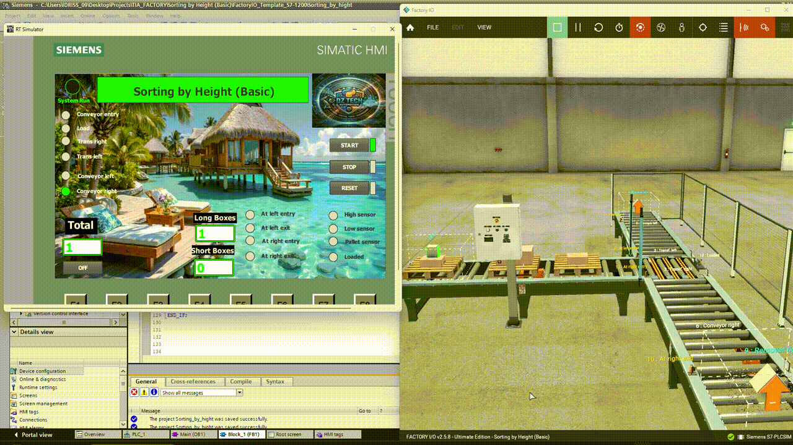

# Sorting by Height (Basic) — SCL

Sorting station for Factory I/O, programmed in SCL on a Siemens S7-1200
(TIA Portal). Long boxes go to the right, short boxes to the left.
Includes a custom HMI with separate counters.

## Features
- State-machine sequence (CASE) with 4 steps
- Height decision latched while the box passes the sensors
- TON timer to keep the transfer rollers on until the pallet leaves
- Total / long / short counters on the HMI
- Start / Stop / Reset / Emergency stop handling

## Requirements
- TIA Portal V16 with PLCSIM V16
- Factory I/O 
- PLC: CPU 1211C DC/DC/DC

## State machine
| Step | Description | Next when |
|---|---|---|
| 10 | Load box, latch height | Loaded sensor |
| 20 | Move to exit side | Timer after platform clears |
| 30 | Run exit conveyor | Box passed exit sensor |
| 40 | Count, reset latch | immediately → 10 |

## Lessons learned
1. Sensor polarity (NC vs NO) must be verified live, not assumed.
2. Transfer rollers switched off too early; solved with a TON delay.

## How to run
1. Open Factory I/O scene `factoryio/...`.
2. Load `Block_1.scl` as an external source in TIA Portal and compile.
3. Start PLCSIM and press START on the HMI.

## Tags
See `tags/PLC_tags.xlsx`.
